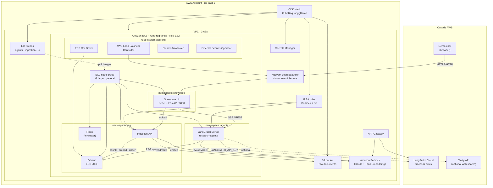
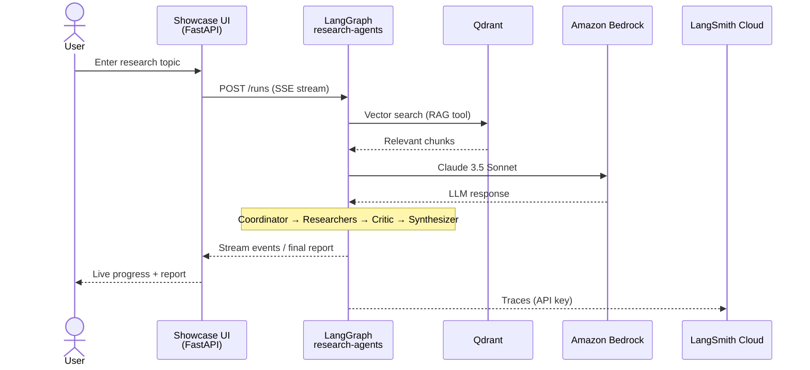
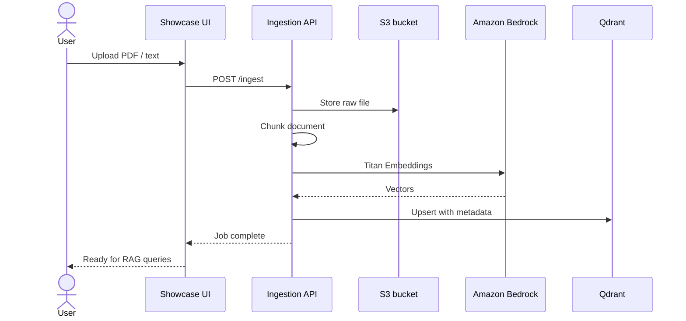
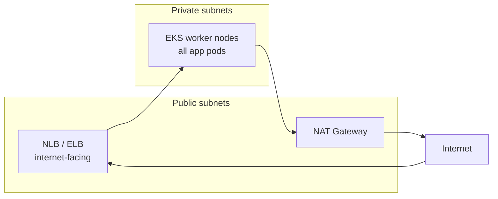
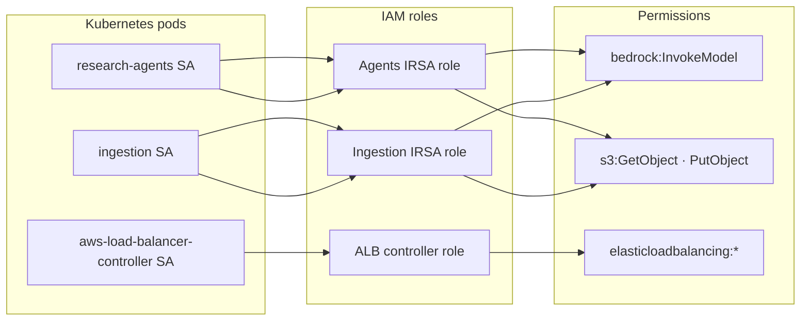
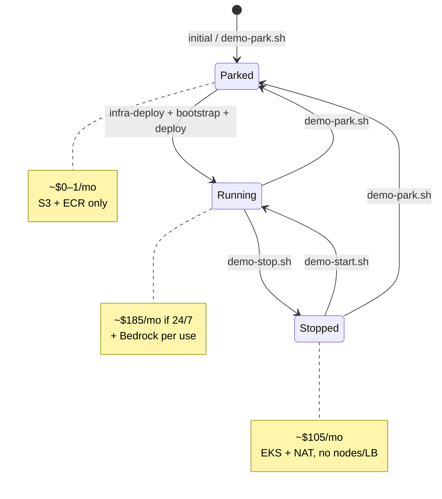

# Architecture Diagram

Visual reference for the **Kube RAG LangGraph** demo deployment (CDK + EKS).  
Open [architecture-diagram.html](./architecture-diagram.html) in a browser for an interactive view.

---

## 1. High-level deployment

What exists after `./scripts/infra-deploy.sh`, `./scripts/bootstrap.sh`, and `./scripts/deploy.sh`:

---

## 2. Research request flow

---

## 3. Document ingestion flow

---

## 4. What CDK provisions vs what scripts deploy

| Layer | Script | Resources |
|-------|--------|-----------|
| **Infrastructure** | `infra-deploy.sh` | VPC, EKS cluster, node group, S3, ECR, IRSA roles, Secrets Manager |
| **Cluster add-ons** | `bootstrap.sh` | EBS CSI, ALB controller (+ IRSA), External Secrets, Cluster Autoscaler, StorageClass |
| **Applications** | `deploy.sh` | Qdrant, Redis, Ingestion, research-agents, Showcase UI + LoadBalancer |

### Demo mode defaults (cost-optimized)

| Included | Not included |
|----------|----------------|
| Single `t3.large` node pool (min 0) | RDS Postgres |
| In-cluster Redis | ElastiCache |
| In-cluster Qdrant on EBS | Self-hosted LangSmith |
| LangSmith Cloud (API key) | Prometheus/Grafana (optional) |

---

## 5. Network layout

- **Ingress:** `showcase-ui` LoadBalancer (internet-facing NLB via AWS Load Balancer Controller)
- **Egress:** NAT gateway for Bedrock, LangSmith, optional Tavily
- **Pods:** run on private subnets; no direct public IPs

---

## 6. IAM (IRSA)

---

## 7. Demo lifecycle

---

## Related docs

- [BUILD_AND_USAGE.md](./BUILD_AND_USAGE.md) — deploy and operate
- [ARCHITECTURE.md](./ARCHITECTURE.md) — design decisions
- [DEMO_COSTS.md](./DEMO_COSTS.md) — cost by mode
