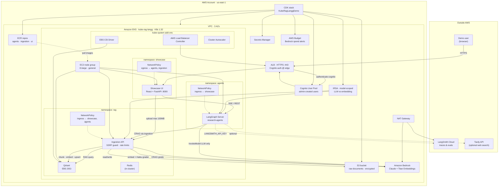
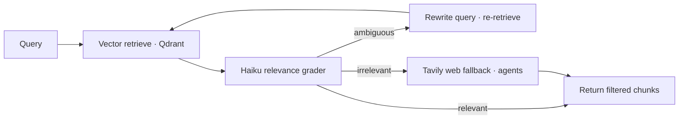
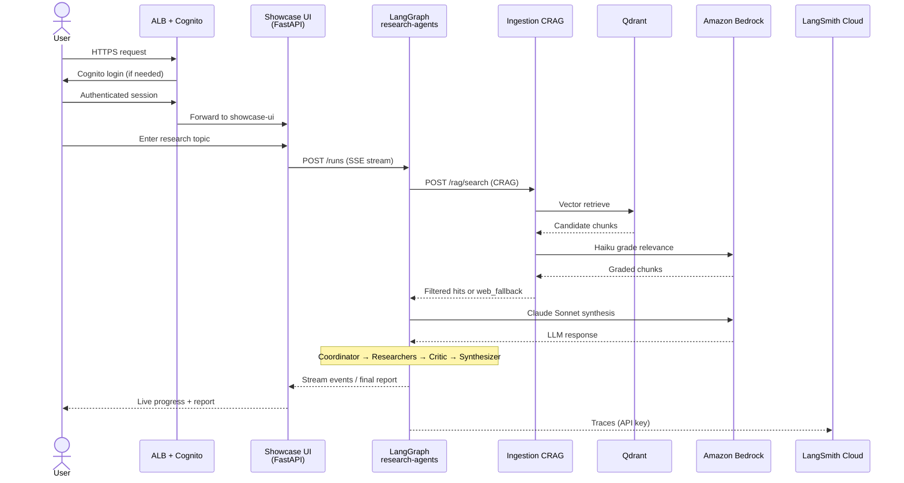
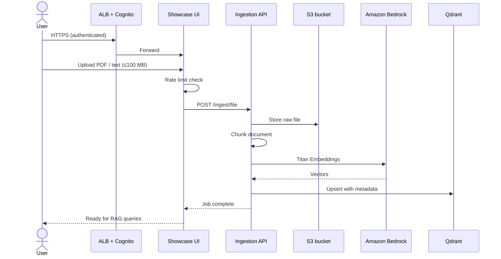
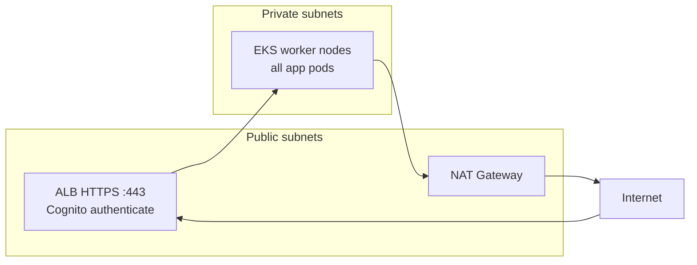
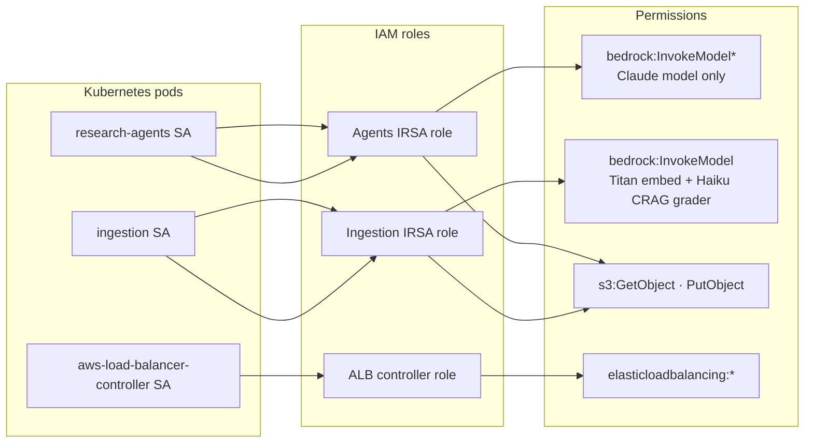
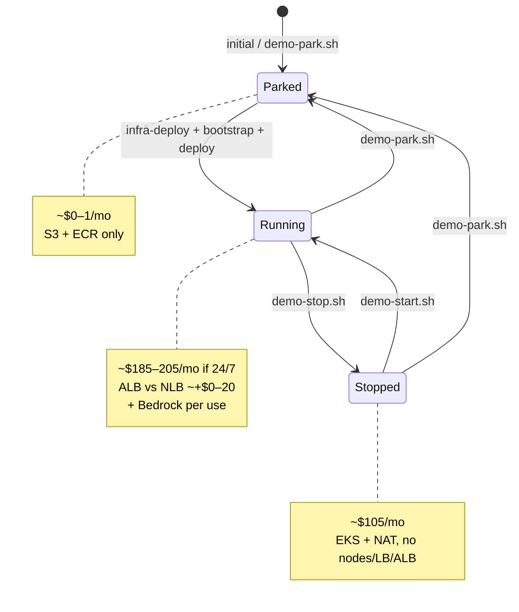

# Architecture Diagram

Visual reference for the **Kube RAG LangGraph** demo deployment (CDK + EKS).  
Open [architecture-diagram.html](./architecture-diagram.html) in a browser for an interactive view.

**Security model:** [SECURITY.md](./SECURITY.md)

---

## 1. High-level deployment (security-conscious demo)

What exists after `./scripts/infra-deploy.sh`, `./scripts/bootstrap.sh`, and `./scripts/deploy.sh` with HTTPS + Cognito enabled:

**Fallback:** If ACM certificate is not yet **ISSUED**, `apply-showcase-access.sh` uses a public HTTP LoadBalancer until DNS validation completes.

---

## 2. Corrective RAG (CRAG)

Shared retrieval path for ingestion API, UI Search tab, and agent `rag_search`:

Configure with `CRAG_ENABLED`, `CRAG_GRADER_MODEL` (Haiku) on ingestion; agents call `/rag/search?crag=true`.

---

## 3. Research request flow

---

## 4. Document ingestion flow

**URL ingest** (`POST /ingest/url`) is cluster-internal only (agents tool); SSRF checks block private IPs and metadata endpoints.

---

## 5. What CDK provisions vs what scripts deploy

| Layer | Script | Resources |
|-------|--------|-----------|
| **Infrastructure** | `infra-deploy.sh` | VPC, EKS, S3, ECR, IRSA (model-scoped), Cognito, ACM cert, Bedrock budget, Secrets Manager |
| **Cluster add-ons** | `bootstrap.sh` | EBS CSI, ALB controller (+ IRSA), External Secrets, Cluster Autoscaler, StorageClass |
| **Applications** | `deploy.sh` | Qdrant, Redis, Ingestion, research-agents, Showcase UI, NetworkPolicies, ALB ingress or LB |

### Security-conscious demo defaults

| Included | Not included |
|----------|----------------|
| Cognito @ ALB (HTTPS) | WAF, IP allowlists |
| Model-scoped Bedrock IRSA | VPC endpoints for Bedrock/S3 |
| Upload cap + API rate limits | Formal pen test / SOC2 |
| SSRF block on URL ingest | Per-user data isolation |
| NetworkPolicies (UI → backends) | Private-only EKS API |
| Bedrock budget email alerts | — |

---

## 6. Network layout

- **Ingress:** ALB with TLS + Cognito (`langrag.automatico.llc` or your `appDomainName`)
- **Egress:** NAT gateway for Bedrock, LangSmith, optional Tavily
- **Pod traffic:** NetworkPolicies restrict showcase → agents/ingestion; qdrant/redis ingress from app pods only

---

## 7. IAM (IRSA)

---

## 8. Demo lifecycle

`demo-stop.sh` removes ALB ingress or LoadBalancer; Cognito pool and budget persist until `demo-park.sh`.

---

## Related docs

- [BUILD_AND_USAGE.md](./BUILD_AND_USAGE.md) — deploy and operate
- [SECURITY.md](./SECURITY.md) — auth, guardrails, out of scope
- [COGNITO.md](./COGNITO.md) — Cognito + ACM setup
- [ARCHITECTURE.md](./ARCHITECTURE.md) — design decisions
- [DEMO_COSTS.md](./DEMO_COSTS.md) — cost by mode
