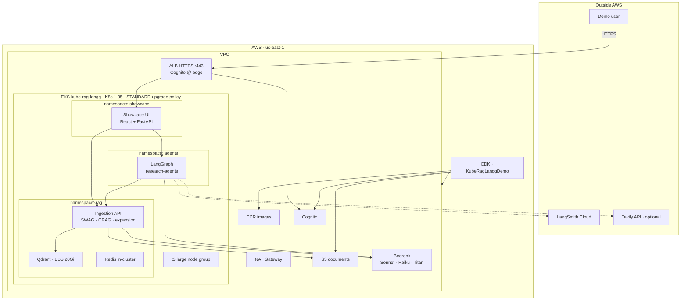
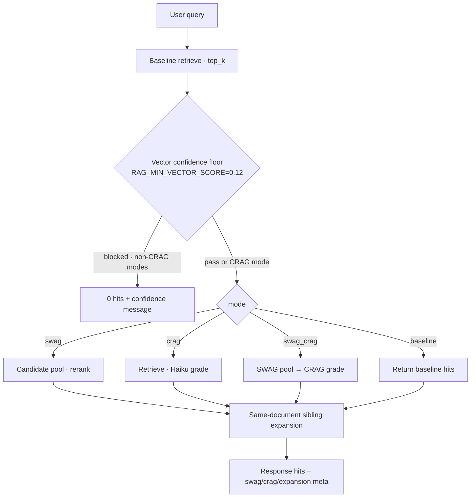
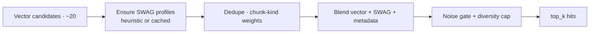
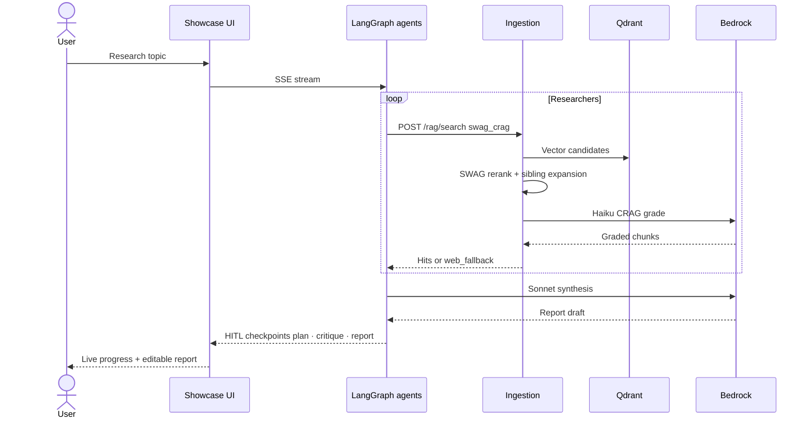
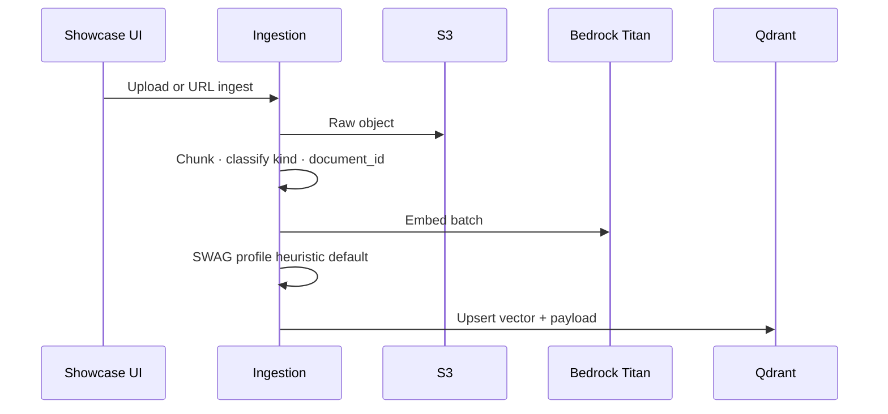
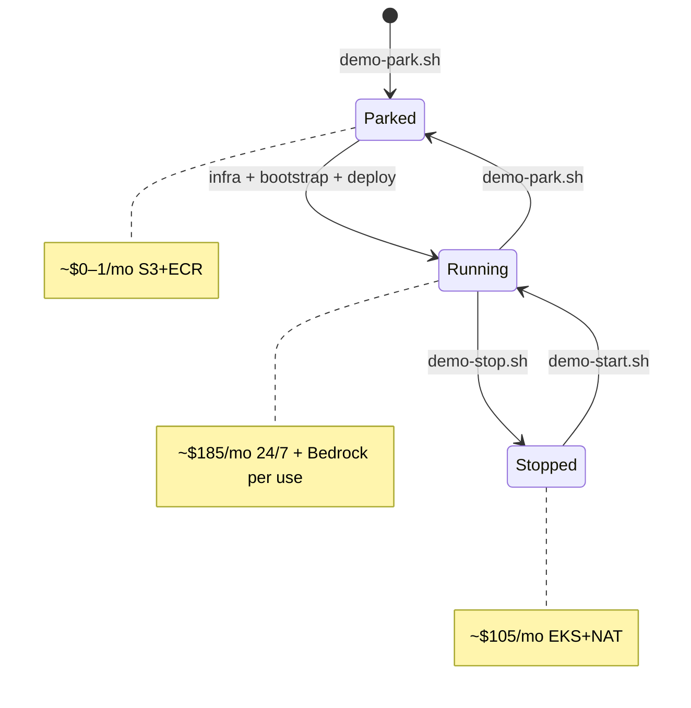

# Architecture Diagram

Visual reference for the **Kube RAG LangGraph** demo on AWS (CDK + EKS).

- **Build & operate:** [BUILD_AND_USAGE.md](./BUILD_AND_USAGE.md)
- **Interactive view:** [architecture-diagram.html](./architecture-diagram.html)
- **Security:** [SECURITY.md](./SECURITY.md)

---

## 1. High-level deployment

After `./scripts/infra-deploy.sh` → `./scripts/bootstrap.sh` → `./scripts/deploy.sh` (with HTTPS + Cognito):

**Live demo URL (example):** `https://langrag.automatico.llc` — DNS CNAME → ALB hostname.

---

## 2. RAG is a pattern; this is our flavor

RAG (retrieval-augmented generation) is an **architecture pattern**, not a single library. This project implements **one concrete flavor**:

| Layer | This project |
|-------|----------------|
| Vector store | Qdrant (single index) |
| Embeddings | Bedrock Titan Embed v2 |
| Chunk metadata | `document_id`, `chunk_index`, `chunk_kind`, `swag_profile` |
| Retrieval modes | `baseline` · `swag` · `crag` · `swag_crag` |
| SWAG | Heuristic profiles + rerank (default, $0) or LLM profiles |
| CRAG | Haiku relevance grader + query rewrite fallback |
| Post-retrieval | Same-document sibling expansion, vector confidence floor |
| Agents | LangGraph research team with `rag_search` tool |

Portable SWAG core also lives in the standalone repo **`/Users/mike/SWAG`** (FAISS/Qdrant, local or cloud). Kube embeds an adapted copy under `ingestion/src/ingestion/swag/` today.

---

## 3. Search pipeline (`POST /rag/search`)

Single Qdrant collection (`research_docs`). No separate SWAG vector index.

### SWAG rerank (inside `swag` mode / before CRAG in `swag_crag`)

### Same-document sibling expansion

When ≥1 chunk from a document passes filtering, pull **sibling chunks** from the same `document_id` in the candidate pool (reading order, no extra LLM). Kept chunk stays rank #1.

| Config | Default |
|--------|---------|
| `RAG_EXPAND_SAME_DOCUMENT` | `true` |
| `RAG_SAME_DOCUMENT_MAX_PER_DOC` | `12` |

### Vector confidence floor

If top vector score &lt; `RAG_MIN_VECTOR_SCORE` (0.12), return **0 hits** for baseline/SWAG modes — blocks off-corpus queries like “what is a shoe”. CRAG modes can still proceed to `web_fallback`.

### UI compare / lift (`compare: true`)

Search tab can request baseline side-by-side plus **mode-scoped lift cards** — only metrics for the active pipeline (e.g. SWAG→CRAG shows `swag_rerank`, `swag_full`, and `swag_crag`, not unrelated CRAG-only lift).

With `RAG_COMPARE_SYMMETRIC_BASELINE=true` (default), baseline for lift is **symmetric**: same sibling expansion and body-only prune applied to vector-only hits so rerank credit is not confounded with post-filters.

Split lift keys:

| Key | Measures |
|-----|----------|
| `swag_rerank` | Vector top-K → after SWAG rerank only |
| `swag_full` | Symmetric baseline → final SWAG path hits |
| `swag_crag` | Symmetric baseline → after CRAG grade (SWAG→CRAG mode) |

**Topic filter:** optional `topic` on `POST /rag/search` and Search tab dropdown — Qdrant metadata filter before retrieve; use to isolate domains (e.g. `ap-procurement`) in mixed corpora.

### CRAG post-grade finalize

When CRAG keeps hits (`partial_rag` / `relevant`), **cross-document pool backfill is disabled** — only same-document sibling expansion and body prune run. Prevents CRAG from discarding noise and the stack immediately refilling from the vector pool.

When CRAG clears all hits (`web_fallback`, kept=0), finalize is skipped so empty results stay empty.

---

## 4. Research request flow

**HITL:** plan → researchers → critique → synthesizer (60–90s) → report.

---

## 5. Ingestion flow

**Demo corpora:**

| Script | Corpus | Cost |
|--------|--------|------|
| `./scripts/seed-demo-corpus.sh` | 5 RAG lesson URLs → topic `rag-demo` (~112 chunks) | &lt;$0.001 embed |
| `./scripts/seed-corpus-batch.sh` | 23 URLs, 6 topics (`corpus-batch.manifest`) append-only | Titan embed only (heuristic SWAG) |

Mixed topics in one collection simulate misfiled / cross-domain folders; combine with Search **topic filter** for domain-scoped pulls.

---

## 6. CDK vs scripts

| Layer | Script | Delivers |
|-------|--------|----------|
| Infra | `infra-deploy.sh` | VPC, EKS 1.35, S3, ECR, IRSA, Cognito, ACM, budget |
| Cluster | `bootstrap.sh` | EBS CSI + IRSA, ALB controller, autoscaler, **STANDARD** EKS upgrade policy |
| Apps | `deploy.sh` | Qdrant, Redis, ingestion, agents, UI |

---

## 7. IAM (IRSA)

| Pod | Bedrock scope | S3 |
|-----|---------------|-----|
| `research-agents` | Claude Sonnet 4.6 | read/write documents |
| `ingestion` | Titan embed + Haiku CRAG (+ optional SWAG LLM) | read/write documents |

---

## 8. Demo lifecycle & cost

See [DEMO_COSTS.md](./DEMO_COSTS.md) — avoid EKS **extended support** (~$360/mo extra); cluster uses `upgradePolicy: STANDARD`.

---

## 9. Validation & regression

| Script | Cost | Checks |
|--------|------|--------|
| `./scripts/validate-project.sh` | $0 | pytest + offline SWAG integrity |
| `./scripts/validate-project.sh --live-smoke` | ~1 Titan embed | Health + baseline search |
| `./scripts/benchmark-query-battery.sh` | ~30 embeds + CRAG cases | 14-case eval sheet, 80% pass |

---

## Related docs

| Doc | Purpose |
|-----|---------|
| [BUILD_AND_USAGE.md](./BUILD_AND_USAGE.md) | Step-by-step deploy and usage |
| [TUNING_PLAN.md](./TUNING_PLAN.md) | Cost-conscious seeding and SWAG/CRAG tuning loop |
| [ARCHITECTURE.md](./ARCHITECTURE.md) | Design decisions |
| [DEMO_COSTS.md](./DEMO_COSTS.md) | Billing by mode |
| [SECURITY.md](./SECURITY.md) | Auth and guardrails |
